<div align="center">

<a href="https://github.com/ishandutta2007/Awesome-Specialized-RFP-Response-Generation-Platforms">
  
</a>

# 📑 Awesome Specialized RFP Response Generation Platforms 🚀

<p align="center">
  <strong>Curated Directory of Enterprise SaaS Solutions &amp; Open-Source Projects for Automated Proposal Generation, RAG Answer Retrieval &amp; Security Questionnaire Orchestration</strong>
</p>

<p align="center">
  <a href="https://github.com/ishandutta2007/Awesome-Awesome-Awesome"></a>
  <a href="https://discord.gg/jc4xtF58Ve"></a>
  <a href="https://github.com/ishandutta2007/Awesome-Specialized-RFP-Response-Generation-Platforms/stargazers"></a>
  <a href="https://github.com/ishandutta2007/Awesome-Specialized-RFP-Response-Generation-Platforms/network/members"></a>
  <a href="https://github.com/ishandutta2007/Awesome-Specialized-RFP-Response-Generation-Platforms/blob/main/LICENSE"></a>
  <a href="https://github.com/ishandutta2007/Awesome-Specialized-RFP-Response-Generation-Platforms/pulls"></a>
  <a href="https://github.com/ishandutta2007"></a>
</p>

</div>

---

## 📖 Table of Contents

- [🎯 Overview &amp; Domain Definition](#-overview--domain-definition)
- [🌐 Sector Overview &amp; Market Dynamics](#-sector-overview--market-dynamics)
- [🏢 Enterprise SaaS &amp; Commercial Platforms](#-enterprise-saas--commercial-platforms)
- [💻 Open-Source GitHub Projects](#-open-source-github-projects)
- [🔬 Academic &amp; Local Privacy Frameworks](#-academic--local-privacy-frameworks)
- [🏗️ Architectural Blueprint of Modern RFP Systems](#️-architectural-blueprint-of-modern-rfp-systems)
- [❓ Frequently Asked Questions (FAQ)](#-frequently-asked-questions-faq)
- [🤝 How to Contribute](#-how-to-contribute)
- [💖 Support &amp; Sponsorship](#-support--sponsorship)
- [📈 Star History](#star-history)
- [⚖️ Disclaimer](#-disclaimer)

---

## 🎯 Overview &amp; Domain Definition

**Specialized RFP (Request for Proposal) Response Generation Platforms** are dedicated systems designed to accelerate, automate, and govern how sales, bid, capture, and presales engineering teams complete:
- 📝 **RFPs &amp; RFIs:** Complex commercial and public tender solicitations with hundreds of technical and operational questions.
- 🛡️ **Security Questionnaires &amp; DDQs:** Standardized cybersecurity assessments (SIG, CAIQ, SOC 2, HIPAA, GDPR vendor risk reviews).
- 🤝 **Federal &amp; Defense Bids:** High-stakes proposals requiring strict compliance matrices, FAR/DFARS mapping, and Shipley-aligned capture management.

Modern solutions leverage **Retrieval-Augmented Generation (RAG)**, **vector databases**, **multi-agent architectures**, and **centralized answer libraries** to retrieve verified corporate knowledge, generate hallucination-resistant first drafts, and enforce strict human-in-the-loop (HITL) approval workflows.

---

## 🌐 Sector Overview &amp; Market Dynamics

The global RFP and proposal response automation software market is estimated at **$3.8 billion in 2026** and is projected to expand at a compound annual growth rate (CAGR) of **~14.2%** to surpass **$7.5 billion by 2031**, accelerated by enterprise generative AI adoption and expanding regulatory compliance mandates.

The sector exhibits **moderate fragmentation** rather than a winner-take-all dynamic. While entrenched category leaders like **Responsive (formerly RFPIO)** and **Loopio** anchor large enterprise accounts with vast governance libraries, generative AI has lowered development barriers. Consequently, a new cohort of specialized AI-native startups and open-source self-hosted frameworks are thriving across specific verticals—such as federal defense contracting, European public procurement, local privacy-first deployments, and automated cybersecurity questionnaires.

---

## 🏢 Enterprise SaaS &amp; Commercial Platforms

The following table benchmarks notable commercial SaaS platforms. Rows are sorted in **descending order by company scale** (estimated valuation, annual recurring revenue, and institutional capital raised).

| 🏢 Platform | 📊 Scale (Valuation / ARR / Funding) | 💰 Starting Price | 🎁 Free Tier / Trial Limits | 🚀 Key Capabilities &amp; Target Audience |
| :--- | :--- | :--- | :--- | :--- |
| **[Responsive](https://www.responsive.io/)** *(formerly RFPIO)* | **~$400M–$500M Est. Valuation**<br>• ~$90M–$110M+ ARR<br>• $64M+ VC funding<br>• $1T+ opportunities managed | **~$542 / month**<br>*(~$6,500/yr billed annually for Essentials/Lite tier; median enterprise contract ~$13,910/yr)* | **No free forever tier**<br>• **14-day guided sandbox trial** upon sales qualification with full library features and demo workspace | Strategic Response Management (SRM) category leader; dual content library + AI generator; deep CRM integrations (Salesforce, HubSpot, Jira, Slack, MS Office). |
| **[Loopio](https://www.loopio.com/)** | **~$250M–$300M Est. Valuation**<br>• ~$35M–$45M ARR<br>• $200M CAD (~$160M USD) strategic investment from Sumeru Equity | **~$1,667 / month**<br>*(~$20,000/yr billed annually for Foundations package; median contract ~$20,856/yr)* | **No free forever tier**<br>• **14-day evaluation sandbox** upon sales consult + 30-min live guided interactive hands-on workshop | Industry benchmark for enterprise content governance; automated SME review cycles, project tracking, and multi-library permissions for global sales forces. |
| **[RFP360](https://www.rfp360.com/)** *(by Responsive)* | **~$40M–$60M Acquisition Valuation**<br>• Acquired by Responsive in 2021<br>• $1.5M prior ARR; $12M prior funding | **~$375 / month**<br>*(~$4,500/yr billed annually, or ~$50/user/mo for supplier response tiers)* | **No free forever tier**<br>• **14-day supplier response evaluation sandbox** when invited by registered buyers to submit bids | Dual-sided platform serving both procurement buyers issuing RFPs and vendor sales teams responding; automated questionnaire parsing and scoring. |
| **[QorusDocs](https://www.qorusdocs.com/)** | **~$35M–$50M Est. Valuation**<br>• ~$10.4M ARR<br>• $15M+ funding (WestRiver Group) | **~$500 / month**<br>*(~$6,000/yr billed annually for Proposal Pro; typically $75–$100/seat/mo, min. 5 seats)* | **No free forever tier**<br>• **14-day free trial** via Microsoft AppSource with full Word and PowerPoint add-in capabilities | Native Microsoft 365 proposal generator embedded directly into Word, PowerPoint, Excel, and Outlook; ideal for slide-heavy pitches and technical bids. |
| **[Ombud](https://ombud.com/)** | **~$20M–$30M Est. Valuation**<br>• ~$8M–$10M ARR<br>• Private enterprise RevOps backing | **~$833 / month**<br>*(~$10,000/yr billed annually for base platform license)* | **No free forever tier**<br>• **30-day proof-of-concept (PoC) pilot** for enterprise sales engineering teams with custom knowledge ingestion | Pre-sales Operating System with context-aware "Ombuddies" AI assistants, strict traceability between RFP inputs and final bids, and versioned approval states. |
| **[Inventive AI](https://www.inventive.ai/)** | **~$15M–$20M Est. Valuation**<br>• ~$1.7M ARR<br>• $4M Seed (Sierra Ventures, Y Combinator, General Catalyst) | **~$833 / month**<br>*(~$10,000/yr billed annually; unlimited user seats + 50 questionnaire credits)* | **No free forever tier**<br>• **14-day scoped pilot trial** including 2 full sample questionnaire ingestions and AI draft benchmarks | Agentic AI drafting with >70% workflow speedup; unlimited seat model with rollover credits; automated security questionnaire answering and multi-source RAG. |
| **[AutoRFP.ai](https://autorfp.ai/)** | **~$10M–$15M Est. Valuation**<br>• ~$1.5M ARR<br>• VC-backed Seed &amp; Accelerator funding | **$899 / month**<br>*($10,788/yr billed annually for Scale Plan; 24 projects/yr + unlimited seats)* | **No free forever tier**<br>• **14-day interactive demo sandbox** + **30-day money-back guarantee** upon paid plan onboarding | ISO 27001 &amp; SOC 2 certified AI-native platform; automated response drafting, AI Reviewer scorecards, and unlimited user seats. |
| **[Expedience Software](https://www.expediencesoftware.com/)** | **~$5M–$10M Est. Valuation**<br>• ~$1M–$2M ARR<br>• Bootstrapped profitable enterprise SaaS | **~$500 / month**<br>*(~$6,000/yr billed annually for core Office-native proposal suite)* | **No free forever tier**<br>• **14-day personalized trial evaluation** with sample document audits using customer proposal templates | 100% native inside Microsoft Word and Excel; zero web portal friction; robust document compilation for complex compliance bids without per-seat reviewer fees. |
| **[Bidara](https://www.bidara.ai/)** | **~$2M–$5M Est. Valuation**<br>• &lt;$1M ARR<br>• Seed-stage AI startup | **$299 / month**<br>*($2,990/yr billed annually for Starter Plan; up to 5 active proposals/month)* | **5-day free trial**<br>• **No credit card required**; includes 1 sample RFP upload and full competitor comparison tooling | Transparent pricing and competitive comparison hub; AI-first proposal generation with rapid questionnaire extraction and lightweight interface. |
| **[Tenderbolt AI](https://www.tenderbolt.ai/)** | **~$1M–$3M Est. Valuation**<br>• &lt;$500K ARR<br>• Bootstrapped EU AI startup | **€39 / month** *(~$42/mo SMB starter)*<br>• Baseline Enterprise from **€833/mo** *(€10,000/yr)* | **Free forever plan available**<br>• **1 tender analysis/month** (max 10 pages); or 7-day Pro free trial with full feature access upon request | European-hosted AI platform with zero-hallucination guarantee; analyzes public tenders, RFQs, and government bids in multi-language EU formats. |

---

## 💻 Open-Source GitHub Projects

Below is a comprehensive collection of active open-source RFP automation engines, questionnaire responders, and proposal accelerators. Repositories are sorted in **descending order by GitHub star count**.

### 1. [run-llama/auto_rfp](https://github.com/run-llama/auto_rfp) [](https://github.com/run-llama/auto_rfp/stargazers)
- **Description:** Full-stack RFP automation platform created by the LlamaIndex team. Features multi-tenant organization and project management, automated document question extraction, and multi-step AI answer generation.
- **Tech Stack:** Python, LlamaIndex, Next.js, Docker, LlamaCloud.
- **Key Capabilities:** Automatically splits uploaded complex RFP PDFs into isolated question items, retrieves relevant context from indexed knowledge repositories, and compiles reviewed outputs into client-ready documents.

### 2. [microsoft/agent-for-rfp-response-solution-accelerator](https://github.com/microsoft/agent-for-rfp-response-solution-accelerator) [](https://github.com/microsoft/agent-for-rfp-response-solution-accelerator/stargazers)
- **Description:** Microsoft's official solution accelerator for building intelligent RFP response agents on enterprise infrastructure.
- **Tech Stack:** Azure OpenAI, Semantic Kernel, Azure AI Search, Python, C#.
- **Key Capabilities:** Production-grade blueprint demonstrating how to orchestrate multi-agent review workflows, enforce enterprise security governance, and generate cited bid responses from internal documentation.

### 3. [aws-samples/aws-genai-rfpassistant](https://github.com/aws-samples/aws-genai-rfpassistant) [](https://github.com/aws-samples/aws-genai-rfpassistant/stargazers)
- **Description:** Enterprise Generative AI Request for Proposal (RFP) Assistant reference implementation built by AWS Solutions Architecture.
- **Tech Stack:** Amazon Bedrock (Anthropic Claude), AWS CDK, OpenSearch Serverless, AWS Lambda, Python.
- **Key Capabilities:** Infrastructure-as-code for deploying a serverless, compliant RFP assistant that ingests corporate collateral into OpenSearch vector embeddings and generates grounded proposal sections.

### 4. [lesteroliver911/openai-rfp-response-analyzer](https://github.com/lesteroliver911/openai-rfp-response-analyzer) [](https://github.com/lesteroliver911/openai-rfp-response-analyzer/stargazers)
- **Description:** Interactive Flask web application that utilizes OpenAI language models to analyze, compare, and audit RFP requirements against candidate responses.
- **Tech Stack:** Python, Flask, OpenAI API, PyPDF2.
- **Key Capabilities:** Provides requirement-to-response gap analysis, compliance scoring matrices, and an interactive chat interface to interrogate proposal coverage.

### 5. [aniket-work/autonomous-rfp-agent](https://github.com/aniket-work/autonomous-rfp-agent) [](https://github.com/aniket-work/autonomous-rfp-agent/stargazers)
- **Description:** Proof-of-concept autonomous multi-agent system designed to handle the end-to-end lifecycle of technical RFP response preparation.
- **Tech Stack:** Python, LangChain, Multi-Agent Orchestration, Streamlit.
- **Key Capabilities:** Decomposes complex questionnaire files, distributes queries to specialized sub-agents (architecture, security, legal, pricing), and synthesizes validated draft answers.

### 6. [AnshMNSoni/B2B-RFP-Agent](https://github.com/AnshMNSoni/B2B-RFP-Agent) [](https://github.com/AnshMNSoni/B2B-RFP-Agent/stargazers)
- **Description:** AI-powered B2B enterprise application for automated Request for Proposal processing, SKU technical matching, and quote generation.
- **Tech Stack:** Python, FastAPI, React, LLM Chains.
- **Key Capabilities:** Ingests manufacturer and distributor requirement catalogs, performs semantic matching against product inventories, and outputs line-item bid estimates.

### 7. [degerahmet/q-flow](https://github.com/degerahmet/q-flow) [](https://github.com/degerahmet/q-flow/stargazers)
- **Description:** Event-driven AI-powered RAG agent specifically engineered for automating security questionnaires (SIG, CAIQ) and spreadsheet RFPs.
- **Tech Stack:** Python, FastAPI, Celery, Redis, ChromaDB.
- **Key Capabilities:** Ingests internal compliance documentation, matches historical answers, generates high-confidence drafts, and outputs directly into native multi-sheet Excel files.

### 8. [Parth-Gochhwal/RFP-IGNITE](https://github.com/Parth-Gochhwal/RFP-IGNITE) [](https://github.com/Parth-Gochhwal/RFP-IGNITE/stargazers)
- **Description:** Agentic RFP response system that orchestrates Sales, Technical, and Pricing agents with strict human-in-the-loop governance.
- **Tech Stack:** Python, LangGraph, Streamlit, Vector Database.
- **Key Capabilities:** Separates proposal duties into domain-specialized agents with auditable decision logs and approval gates before finalizing commercial bids.

### 9. [jordanhenning32/rfp-factory](https://github.com/jordanhenning32/rfp-factory) [](https://github.com/jordanhenning32/rfp-factory/stargazers)
- **Description:** Multi-agent pipeline tailored for government and federal contracting that converts complex solicitations into submission-ready proposals in ~2 hours.
- **Tech Stack:** Python, Claude API, RAG, Markdown parsing.
- **Key Capabilities:** Enforces Federal Acquisition Regulation (FAR) compliance guardrails, creates compliance matrices, and provides human checkpoints for color-team reviews.

### 10. [somuai/cable-rfp-automation](https://github.com/somuai/cable-rfp-automation) [](https://github.com/somuai/cable-rfp-automation/stargazers)
- **Description:** Autonomous multi-agent AI system for B2B government cable and hardware RFP discovery, technical specification extraction, and bill of quantities (BOQ) pricing.
- **Tech Stack:** Python, LLM Agentic Pipelines, Vector Store.
- **Key Capabilities:** Parses dense technical tender specifications, maps requirements against manufacturer catalogs, and generates pricing bids.

### 11. [Satyapraveenv/ai-rfp-response-generator](https://github.com/Satyapraveenv/ai-rfp-response-generator) [](https://github.com/Satyapraveenv/ai-rfp-response-generator/stargazers)
- **Description:** AI-powered enterprise RFP response automation tool focused on context extraction, quality scoring, and executive narrative generation.
- **Tech Stack:** Python, OpenAI API, Streamlit.
- **Key Capabilities:** Streamlines multi-million dollar proposal pursuits with automated executive summaries and requirement coverage metrics.

### 12. [RanitDERIA/tata-rfp](https://github.com/RanitDERIA/tata-rfp) [](https://github.com/RanitDERIA/tata-rfp/stargazers)
- **Description:** AI RFP response platform leveraging LlamaIndex and GPT-4 to extract questionnaire items, index corporate knowledge bases, and generate contextual responses.
- **Tech Stack:** Python, LlamaIndex, OpenAI GPT-4.
- **Key Capabilities:** Reduces initial response drafting time by up to 80% through semantic search across historical proposal submissions.

### 13. [MiltonJ23/Kliops](https://github.com/MiltonJ23/Kliops) [](https://github.com/MiltonJ23/Kliops/stargazers)
- **Description:** High-performance agentic RFP responder written in Go for construction and public sector procurement.
- **Tech Stack:** Go (Golang), Gemma 4, Ollama, Qdrant, MinIO, PostgreSQL, RabbitMQ.
- **Key Capabilities:** Hexagonal architecture running locally with open-weight models; extracts requirements, stores vectors in Qdrant, and generates technical bid memorandums.

### 14. [LegionIO/lex-rfp](https://github.com/LegionIO/lex-rfp) [](https://github.com/LegionIO/lex-rfp/stargazers)
- **Description:** Comprehensive open-source Ruby proposal and RFP automation platform connecting into the LegionIO ecosystem.
- **Tech Stack:** Ruby, Apollo Knowledge Store, LLM Pipelines.
- **Key Capabilities:** Features four distinct sub-modules: **Ingest** (PDF/DOCX/Excel parsing), **Generate** (template compliance matrix &amp; section drafting), **Review** (status tracking &amp; SME approvals), and **Analytics** (win rate tracking &amp; quality scoring).

### 15. [triplex1/rfp-questionnaire-autoresponder](https://github.com/triplex1/rfp-questionnaire-autoresponder) [](https://github.com/triplex1/rfp-questionnaire-autoresponder/stargazers)
- **Description:** Open-source security questionnaire and RFP auto-responder with zero server-side retention.
- **Tech Stack:** TypeScript, Node.js, Anthropic Claude API.
- **Key Capabilities:** Grounded in local security profiles (SOC 2 reports, ISO policies); flags missing compliance evidence instead of hallucinating certifications.

### 16. [bhargavhari2001-cloud/BidCraft](https://github.com/bhargavhari2001-cloud/BidCraft) [](https://github.com/bhargavhari2001-cloud/BidCraft/stargazers)
- **Description:** RAG-based RFP automation engine that extracts questions from solicitations and retrieves approved corporate answers with confidence scoring.
- **Tech Stack:** Python, LangChain, Vector Embeddings.
- **Key Capabilities:** Automated parsing of PDF/Word tables into queryable prompts with confidence-weighted source attribution.

### 17. [sridivya9398/AutoProposal](https://github.com/sridivya9398/AutoProposal) [](https://github.com/sridivya9398/AutoProposal/stargazers)
- **Description:** Enterprise proposal and security questionnaire responder utilizing Agentic Workflows and GraphRAG.
- **Tech Stack:** Python, GraphRAG, Knowledge Graphs, OpenAI.
- **Key Capabilities:** Combines graph-based relational entity mapping with vector similarity to generate accurate answers for complex organizational questions.

### 18. [ShamirAli55/BidIQ](https://github.com/ShamirAli55/BidIQ) [](https://github.com/ShamirAli55/BidIQ/stargazers)
- **Description:** Automated RFP and tender response engine with built-in win probability estimation.
- **Tech Stack:** Python, ChromaDB, Scikit-learn, Streamlit.
- **Key Capabilities:** Ingests RFP PDFs, matches requirements against past bid databases via RAG, drafts proposal paragraphs, and computes win probability scores.

### 19. [SaiRam-Peruri/RAG-PROJECT](https://github.com/SaiRam-Peruri/RAG-PROJECT) [](https://github.com/SaiRam-Peruri/RAG-PROJECT/stargazers)
- **Description:** RAG framework automating federal proposal drafting with compliance matrices and requirement trackers.
- **Tech Stack:** Python, ChromaDB, OpenAI Embeddings.
- **Key Capabilities:** Monitors new RFP releases, chunks past proposal corpora, and outputs cited proposal sections along with compliance matrices.

### 20. [mayva-tech/rfp-response-draft-assistant](https://github.com/mayva-tech/rfp-response-draft-assistant) [](https://github.com/mayva-tech/rfp-response-draft-assistant/stargazers)
- **Description:** Lightweight drafting assistant generating first-pass RFP responses by matching questions with institutional answer repositories.
- **Tech Stack:** Python, Natural Language Matching, Streamlit.
- **Key Capabilities:** Fast, no-frills setup designed for small presales teams to eliminate repetitive copying and pasting.

---

## 🔬 Academic &amp; Local Privacy Frameworks

For organizations with stringent data-sovereignty mandates, defense classifications, or zero-cloud data retention rules:

- 🛡️ **[@blakelypritchard/cse-toolkit](https://www.npmjs.com/package/@blakelypritchard/cse-toolkit)**  
  **Privacy-First Local RFP Response Generator (Node.js &amp; MCP):**  
  Indexes your product knowledge base, runs semantic searches, and generates grounded RFP answers without sending any proprietary text to external cloud APIs. Uses a local embedding model (`Xenova/bge-small-en-v1.5`, ~33 MB) cached on your machine and exposes 7 Model Context Protocol (MCP) tools for direct pairing with Claude Code, Cursor, and local IDE assistants.

- 🎓 **[KNOWL Project](https://zenodo.org/records/19774945)** *(Academic Research / Open Access)*  
  **Hybrid Knowledge-Graph &amp; RAG Architecture for Bid Preparation:**  
  Combines Neo4j knowledge graphs, Qdrant vector retrieval, and open-weight LLMs in a secure environment. Validated in an enterprise BPO pilot with an independent content quality score of **9.67/10**, reducing drafting time from hours to **20–30 minutes** and achieving **~70% net time savings** per commercial proposal.

---

## 🏗️ Architectural Blueprint of Modern RFP Systems

A state-of-the-art RFP response system consists of four primary pipeline phases:

```
┌─────────────────┐       ┌────────────────────────┐       ┌──────────────────────┐       ┌──────────────────────┐
│  1. Ingestion   │ ────> │  2. Hybrid Retrieval   │ ────> │  3. Draft Generation │ ────> │  4. Human Governance │
│  & Extraction   │       │     (Vector + KG)      │       │     (Agentic RAG)    │       │     & Export Gate    │
└─────────────────┘       └────────────────────────┘       └──────────────────────┘       └──────────────────────┘
  • Multi-page PDF/         • Dense vector search            • Prompt template with         • SME assignment
    DOCX/Excel tables         (OpenSearch/Qdrant)              compliance guardrails        • Version comparison
  • Question vs. prompt     • Sparse BM25 keyword            • In-line citation tagging     • Confidence scoring
    decomposition             matching                         (evidence linkage)           • Export to DOCX, XLSX,
  • Section classification  • Knowledge Graph entities       • Multi-agent critique           or Microsoft 365
```

---

## ❓ Frequently Asked Questions (FAQ)

<details>
<summary><strong>🔍 What makes Specialized RFP Response Platforms different from general AI writing tools (e.g., ChatGPT)?</strong></summary>

Generic AI chat tools lack three essential capabilities required for commercial RFPs:
1. **Evidence-backed retrieval:** They cannot guarantee that answers strictly reflect certified enterprise policies (SOC 2 reports, technical datasheets) without hallucination.
2. **Spreadsheet &amp; document parsing:** Specialized platforms parse complex nested multi-tab Excel files, compliance matrices, and Word tables while preserving formatting.
3. **Approval governance:** Specialized systems assign specific Subject Matter Experts (SMEs), record audit trails, and maintain freshness cycles on approved answers.
</details>

<details>
<summary><strong>⚖️ SaaS vs. Self-Hosted Open-Source: Which approach should our team adopt?</strong></summary>

- **Adopt SaaS (Responsive, Loopio, AutoRFP, Inventive):** When your priority is rapid time-to-value, seamless Microsoft 365/Salesforce integrations, out-of-the-box vendor maintenance, and collaborative UI workflows for non-technical sales teams.
- **Adopt Open-Source (run-llama/auto_rfp, Kliops, Lex-RFP):** When handling classified government solicitations, proprietary IP that cannot leave private VPCs, air-gapped environments, or when avoiding six-figure per-seat enterprise licensing fees.
</details>

<details>
<summary><strong>🛡️ How do modern platforms prevent AI hallucinations on security questionnaires (DDQs)?</strong></summary>

High-grade platforms employ **strict RAG grounding**:
- Every draft sentence must map to a retrieved chunk from a verified knowledge library.
- If retrieval similarity falls below a confidence threshold (e.g., 85%), the platform explicitly flags the question for SME intervention rather than guessing.
- Built-in compliance reviewers cross-reference generated text against known certifications (ISO 27001, FedRAMP, HIPAA).
</details>

---

## 🤝 How to Contribute

Contributions are warmly welcomed! Help make this ecosystem the most accurate reference on the web:

1. 🍴 **Fork the repository** to your GitHub account.
2. 🌿 **Create a new branch** (`git checkout -b feature/add-new-platform`).
3. 📝 **Add your entry** to either the SaaS table or Open-Source section following the existing structure (name, links, scale, pricing, free tier limits, tech stack).
4. ✅ **Ensure accuracy:** Validate pricing and trial limits against public documentation or official vendor pages.
5. 🚀 **Submit a Pull Request** with a brief summary of the addition.

---

## 💖 Support &amp; Sponsorship

If this curated ecosystem helps you streamline your bid pursuits, choose the right proposal automation platform, or build an open-source RAG engine, please consider supporting the project:

- ⭐ **Star this repository** to improve its discoverability on GitHub!
- 🍴 **Fork &amp; Share** with proposal managers, presales engineers, and AI developers.
- ☕ **Buy a Coffee &amp; Sponsor:** Direct support keeps this repository actively updated with the latest SaaS pricing changes, open-source releases, and benchmark comparisons:  
  👉 **[Sponsor Dashboard on GitHub Sponsors](https://github.com/sponsors/ishandutta2007)**

---

##  Star History

[](https://star-history.dera.page/#ishandutta2007/Awesome-Specialized-RFP-Response-Generation-Platforms&type=date&legend=top-left)

---

## ⚖️ Disclaimer

*This list is community-curated for informational and educational purposes. Mention of vendors, software products, or open-source packages does not constitute an endorsement. Contract values, valuations, pricing tiers, and trial policies change frequently; always consult official vendor documentation and legal counsel before executing procurement contracts or deploying AI systems in production environments.*

---

<p align="center">
  <sub>Maintained with ❤️ by <a href="https://github.com/ishandutta2007">Ishan Dutta</a> and the global open-source community.</sub>
</p>
